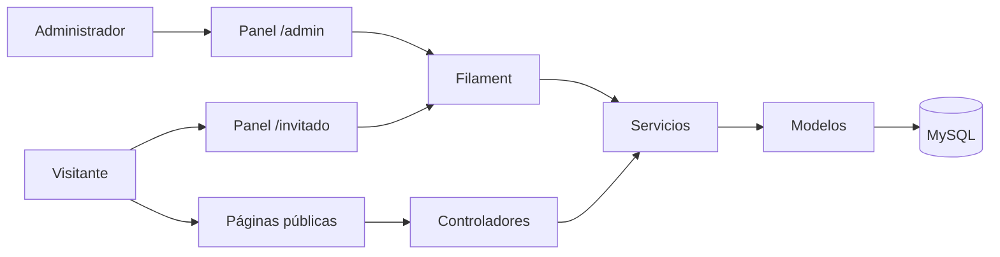

# Arquitectura

## Visión general

Es un monolito Laravel. Filament y Livewire resuelven administración; Blade y controladores entregan vistas públicas, PDF y JSON.

## Capas

- `app/Filament/Resources`: tablas, formularios y acciones.
- `app/Filament/Pages`: competencia, rankings y flujos especiales.
- `resources/views`: Blade, páginas públicas, impresión y PDF.
- `app/Services`: transacciones y reglas reutilizables.
- `app/Models`: relaciones, conversiones, alcances y estado.
- `app/Policies`: autorización por recurso.

La interfaz recopila y valida. Las reglas deportivas deben residir en servicios. Una operación que escribe varias tablas debe ser atómica.

## Paneles

`AdminPanelProvider` configura `/admin` con autenticación, recuperación de contraseña, correo verificado, notificaciones y Shield.

`GuestPanelProvider` configura `/invitado` sin inicio de sesión. `AssignGuestUser` y `AppServiceProvider` aplican los permisos del rol `Jugador`. Toda nueva capacidad pública requiere revisar ese rol.

## Rutas públicas

`routes/web.php` publica torneos, rankings, resultados de cinco quillas, PDF por sección y documentos firmados de transferencias, inscripciones y membresías. Los JSON deben contener sólo información publicada. Las URLs firmadas protegen documentos individuales.

## Autorización

Se combinan Policies, Spatie Permission y Filament Shield. Para un recurso nuevo: definir Policy, registrar permisos, asignar roles, revisar invitado y probar acceso permitido/denegado.

## Archivos

Logos, fotos, reglamentos y comprobantes usan el disco Laravel. Las vistas deben tolerar archivos ausentes. Ejecute `php artisan storage:link` cuando corresponda.

## Livewire

El formulario vive en el estado del componente. Repetidores y selects requieren rutas y claves estables. Reemplazar nodos con HTML externo o claves cambiantes rompe el enlace Livewire. Tras desplegar cambios de formulario ejecute `php artisan optimize:clear`.

## Salud y diagnóstico

- `/up`: salud.
- `storage/logs/laravel.log`: errores.
- `/livewire/update`: respuesta útil ante fallas interactivas.
- tabla `notifications`: avisos administrativos.

## Riesgo conocido

La ruta `/debug-path`, si permanece habilitada, expone rutas internas. Debe eliminarse o limitarse al entorno local en una revisión de seguridad.
