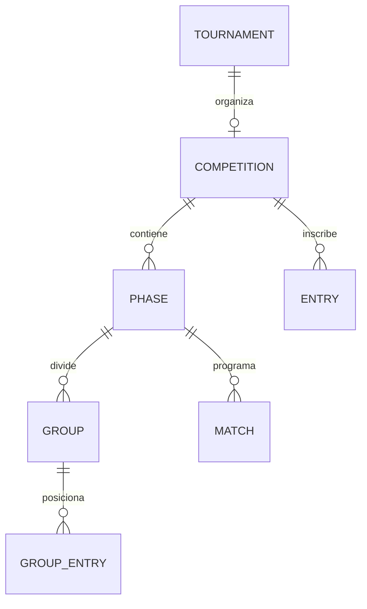

# Modelo de dominio

## Organización y personas

`Country`, `State`, `City`, `Federation` y `Club` representan geografía e instituciones. `User` es la identidad de acceso y `Player` la ficha deportiva: no son equivalentes.

## Disciplinas y categorías

`Discipline`, `DisciplineModality`, `Category`, `PlayerDiscipline`, `PlayerCategoryHistory` y `PlayerCategoryPromotion` mantienen afiliación y evolución deportiva. Un torneo histórico consulta la categoría efectiva de su fecha.

## Membresías y tesorería

`Membership`, `PlayerMembership`, `MembershipPayment`, `BankTransferOrder`, `BankTransferProof` y `BankTransferSetting` administran deuda y cobro. Pago y aprobación son estados distintos.

## Torneos

- `TournamentType`: clase, disciplina, carácter oficial y base de configuración.
- `Tournament`: edición, sede, fechas, modalidad y publicación.
- `TournamentSlot`: cupo/horario.
- `TournamentCategoryPrice`: precio por categoría.
- `TournamentRegistration` y participantes: inscripción individual o grupal.
- `TournamentInstance`: instancia usada para puntuación.
- `TournamentScoringRule` y `TournamentScoringAssignment`: reglas y puntos.

## Cinco quillas

- `FiveQuillasCompetition`: torneo, slug, configuración y estado.
- `FiveQuillasPhase`: tipo, orden, sets, puntos, armado, horarios y clasificación.
- `FiveQuillasEntry`: jugador, inscripción, horario, ranking capturado, semilla, fase de ingreso, posición final y estado.
- `FiveQuillasGroup`: zona.
- `FiveQuillasGroupEntry`: posición y acumulados.
- `FiveQuillasMatch`: ronda, participantes, sets, ganador, propagación, mesa y horario.

El partido distingue sets informados de sets computados para soportar LIBRE y proclamación manual.

## Rankings y reglamentos

`GeneralRanking`, `RankingHistory`, rankings específicos y `RankingSpecialPosition` mantienen clasificación e instantáneas. `TournamentRegulationSetting` define reglas y `TournamentRegulationAudit` registra decisiones y excepciones.

## Datos derivados

| Dato | Fuente autorizada |
|---|---|
| Participante | inscripción aprobada y reglas de afiliación/pago |
| Ranking de ingreso | instantánea de la entrada |
| Tabla de zona | resultados de sus partidos |
| Clasificados | criterio de la fase siguiente |
| Ronda posterior | ganador propagado |
| Posición final | recorrido y desempates |
| Puntos | regla asignada y confirmación idempotente |

Para corregir un total derivado se corrige su fuente y se recalcula la dependencia.
