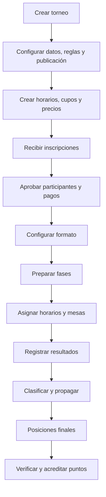

# Torneos y competencia

## Ciclo general

## Creación y publicación

El torneo define nombre, tipo, carácter oficial, disciplina, modalidad, sede, fechas, logo, categorías, inscripción, pago y contactos. El tipo aporta valores iniciales; los overrides reglamentarios deben quedar auditados.

La publicación es independiente de la existencia del registro. Antes de publicar revise fechas, sede, modalidad, cupos, medios y reglamento.

## Inscripciones

Pueden ser individuales o con participantes asociados. El torneo define si exige pago. Sin pago, la aprobación depende de reglas deportivas y cupo. Con pago, la orden y el comprobante pasan por revisión antes de habilitar definitivamente.

Cada horario tiene identidad, inicio, cupo y estado. Los horarios se muestran siempre por fecha y hora. La inscripción aprobada alimenta la competencia; una sincronización no debe duplicar entradas.

## Configuración de fases

Cada fase conserva:

- nombre, orden y tipo;
- fase anterior y posterior;
- método de ingreso/siembra;
- cantidad de sets y puntos de cada set;
- cantidad de clasificados;
- horarios, mesas, duración y descanso;
- división por horario y llenado progresivo;
- categorías de ingreso directo;
- tamaño de llave cuando corresponde.

Tipos: `zones`, `slot_elimination`, `play_in` y `bracket`. Métodos: manual, ranking nacional, resultado anterior, sorteo automático y número de sorteo.

Las reglas de sets pertenecen a cada fase. Es válido disputar zonas a 3 sets y una fase posterior a 5, con puntajes por set diferentes.

## Simultaneidad

Una fase de cruces por horario puede avanzar mientras siguen las zonas de horarios posteriores. La fase no se completa porque un horario terminó: deben estar resueltos todos los horarios programados. Al completar los cruces, sus ganadores se reúnen según la configuración de la fase siguiente.

Si la fase siguiente no depende de que termine toda la anterior, se puede preparar y llenar progresivamente. Sus posiciones y horarios deben quedar visibles.

## Zonas

La carga manual organiza jugadores por horario y posición. `LIBRE` es una posición válida. Un jugador elegido deja de estar disponible en los demás selectores.

Una zona puede editarse mientras ninguno de sus partidos tenga sets informados ni ganador proclamado. El bloqueo se decide por actividad deportiva real, no por la existencia del registro.

Los nombres automáticos continúan desde el mayor número existente en toda la fase, aunque se cambie de horario.

La tabla se recalcula por partidos ganados, diferencia de sets y promedio según la regla vigente. La definición del primer puesto debe propagarse al terminar ese partido, sin esperar todos los partidos de la zona.

## Cruces por horario

Se elige un horario y se enfrentan manualmente primeros de zona con segundos de una zona diferente. Los selectores muestran sólo clasificados disponibles, ordenados primero por puesto y luego por número de zona.

Los cruces se pueden preconfigurar antes de conocer los nombres. Se pueden agregar nuevos cruces aunque otros, incluso del mismo horario, ya tengan ganador. Un cruce iniciado no se elimina ni altera silenciosamente.

## Eliminación directa

La llave usa potencias de dos: 2, 4, 8, 16, 32, 64, 128. En una llave de tamaño `N`, las semillas de primera ronda se emparejan para sumar `N + 1`: 1–N, 2–(N−1), etc. La ronda siguiente repite la lógica con su nuevo tamaño.

El tamaño se calcula con participantes reales y la cantidad que debe avanzar. No se crea una ronda innecesaria. Los lugares vacíos son `LIBRE` y su oponente avanza automáticamente.

En fases con ingresos directos y clasificados:

1. obtener ingresos directos del horario/categoría configurados;
2. usar su ranking capturado para el orden;
3. obtener los clasificados reales de la fase anterior;
4. ordenarlos con el método configurado;
5. calcular la llave y las rondas necesarias hasta la cantidad de clasificados;
6. presentar una vista previa editable antes de reconstruir.

Las posiciones numéricas de la llave son identidad del casillero. Una corrección cambia el jugador, no el número. Sólo se editan partidos no iniciados de la primera ronda; rondas posteriores reciben ganadores.

Si se corrige un participante, se limpian ganador, resultado computado y propagaciones dependientes. No se conserva en una ronda posterior un ganador que dejó de corresponder.

## Resultados

Un partido admite resultados por set o proclamación directa. La proclamación computa un triunfo completo: 3–0 en una fase a 3 sets y 5–0 en una fase a 5 sets, usando los puntos por set configurados. Esto alimenta partido ganado, diferencia, promedio y clasificación.

LIBRE también genera el avance y los valores computados definidos por la regla. Los sets reales permanecen diferenciados de los computados.

El formulario móvil debe conservar alineación de jugadores, sets y acciones. Toda acción de ganador debe identificar claramente el nombre elegido.

## Clasificados

Todas las fases exponen una acción **Ver clasificados**; la lista no queda escondida al final de la llave. Incluye compartir e imprimir.

El orden y las columnas dependen del método de la fase siguiente:

- resultado anterior: posición en zona, diferencia de sets y promedio;
- ranking: ranking capturado;
- sorteo: número de sorteo;
- manual: orden persistido por la organización.

La lista usa valores guardados de la competencia, no ranking recalculado al día de consulta.

## Horarios

Las pestañas se ordenan por `starts_at`. La asignación respeta el bloque/turno: un partido de mañana no puede recibir un horario de tarde. Las rondas dependientes se programan considerando duración y descanso.

## Cierre, posiciones y puntos

La posición final ordena primero por instancia alcanzada y dentro de cada instancia por diferencia de sets descendente y promedio descendente, aplicando los desempates configurados. Las derrotas pueden mapearse a instancias específicas, por ejemplo F1 NAC y F2 NAC.

El campeón se muestra sólo cuando el torneo está realmente finalizado y existe posición final 1. Se usa la foto del jugador si está disponible.

La acreditación de puntos requiere una acción explícita después de verificar posiciones. Debe ser idempotente: repetirla no duplica registros. `commitFinalScoring` consolida los puntos y guarda la evidencia correspondiente.

## Vista pública e impresión

La vista pública muestra información del torneo, campeón cuando corresponde, fases, resultados, sets, horarios, clasificados y posiciones. Administración y público deben interpretar el mismo dato de dominio.

Cada sección ofrece compartir e imprimir. Los PDF incluyen encabezado con logo/nombre/sede/fecha/tipo/modalidad y pie de página repetido. La impresión de la llave tiene su propio diseño y no debe modificar la vista en pantalla.
